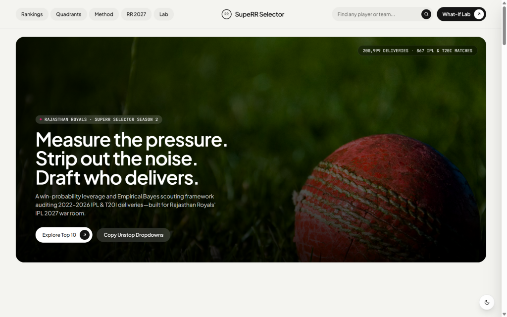
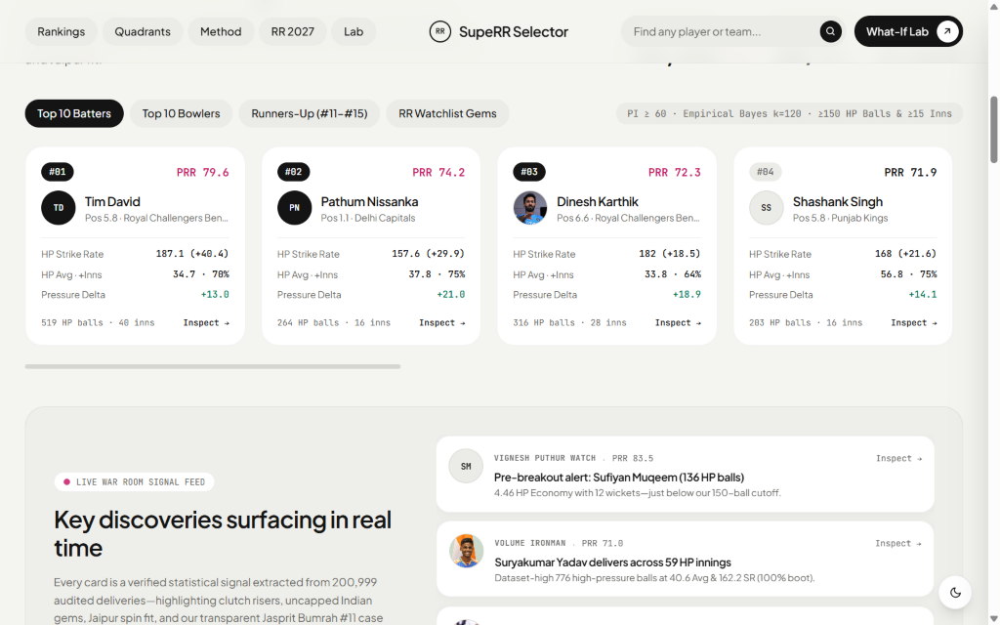
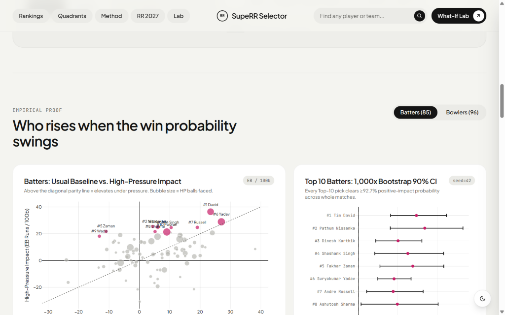
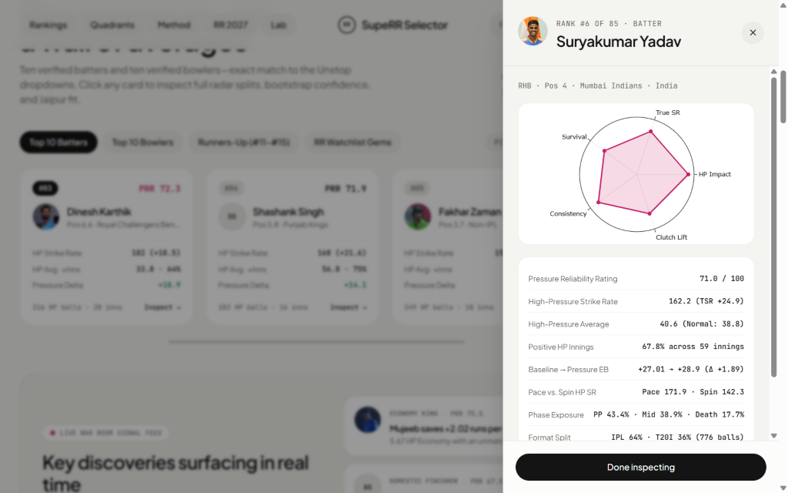

# SupeRR Selector Season 2 — Rajasthan Royals IPL 2027 Pressure Scouting Dashboard

[-2563EB?style=for-the-badge)](https://yash-chavan-29.github.io/superr-selector-s2-dashboard/)

> **Live Interactive War Room:** **[https://yash-chavan-29.github.io/superr-selector-s2-dashboard/](https://yash-chavan-29.github.io/superr-selector-s2-dashboard/)**

A calm, editorial T20 pressure-analytics scouting hub built for **Rajasthan Royals — SupeRR Selector Season 2 (Round 1: Identify the Most Reliable Players Under Pressure)**. Powered by an empirical Win-Probability Leverage model, context-adjusted Expected Value baselines, Empirical Bayes shrinkage (`k = 120`), and 1,000x match-level bootstrapping across **200,999 IPL & T20I deliveries (2022–2026)**.

---

## Live Dashboard Previews

### 1. Editorial Hero & Instant Cross-Role Player Search

### 2. Top-10 Snap-Scroll Player Cards & Live War Room Signal Feed (Animated List)

### 3. Usual Baseline vs. High-Pressure Clutch Quadrants & 1,000x Bootstrap 90% CIs

### 4. Interactive Slide-Over Player Scouting Drawer (5-Axis Radar & Phase Splits)

---

## Official Unstop Round 1 Rankings (Exact Match to Report & Dropdowns)

| Rank | Top 10 Batters Under Pressure | PRR | HP SR (TSR) | +Inns % | Top 10 Bowlers Under Pressure | PRR | HP Econ (Saved) | Wkts (SR) |
| :---: | :--- | :---: | :---: | :---: | :--- | :---: | :---: | :---: |
| **#1** | **Tim David** | `79.6` | `187.1 (+40.4)` | `70%` | **Varun Chakravarthy** | `79.8` | `7.32 (+1.08)` | `43 (12.9)` |
| **#2** | **Pathum Nissanka** | `74.2` | `157.6 (+29.9)` | `75%` | **Adam Zampa** | `76.8` | `7.63 (+0.98)` | `24 (12.1)` |
| **#3** | **Dinesh Karthik** | `72.3` | `182.0 (+18.5)` | `64%` | **Mujeeb Ur Rahman** | `75.5` | `5.67 (+2.02)` | `12 (15.2)` |
| **#4** | **Shashank Singh** | `71.9` | `168.0 (+21.6)` | `75%` | **Josh Hazlewood** | `75.3` | `7.53 (+1.39)` | `33 (13.2)` |
| **#5** | **Fakhar Zaman** | `71.6` | `153.8 (+27.1)` | `72%` | **Rashid Khan** | `74.4` | `6.94 (+1.49)` | `47 (14.0)` |
| **#6** | **Suryakumar Yadav** | `71.0` | `162.2 (+24.9)` | `68%` | **Mitchell Santner** | `73.2` | `6.62 (+1.54)` | `23 (16.3)` |
| **#7** | **Andre Russell** | `68.5` | `176.3 (+28.2)` | `59%` | **Mohammad Nawaz** | `72.0` | `6.45 (+1.07)` | `18 (14.1)` |
| **#8** | **Ashutosh Sharma** | `67.5` | `177.1 (+25.3)` | `67%` | **Sunil Narine** | `71.8` | `7.11 (+1.47)` | `22 (15.7)` |
| **#9** | **Matthew Wade** | `67.1` | `151.1 (+4.5)` | `76%` | **Mahedi Hasan** | `71.4` | `6.09 (+1.10)` | `14 (14.8)` |
| **#10** | **Nicholas Pooran** | `66.3` | `160.6 (+16.6)` | `57%` | **Kuldeep Yadav** | `71.2` | `7.46 (+1.25)` | `28 (15.2)` |

---

## Interactive War Room Features
* **Instant Cross-Role Search & Player Portraits:** Type any player or IPL team in the top bar (181 eligible players + 11 high-ceiling watchlist gems) to jump straight into their Slide-Over Scouting Drawer.
* **Animated List Live Signal Feed:** Spring-eased live feed surfacing clutch outliers, uncapped Indian gems (**Shashank Singh #4**, **Ashutosh Sharma #8**), and the transparent **Jasprit Bumrah (#11) Baseline Compression Case Study**.
* **Interactive "What-If" PRR Weight Simulator:** Perturb `HP Impact %`, `Pressure Resilience %`, and `Consistency %` live across all 181 players and monitor real-time Top-10 stability.
* **RR 2027 Auction & Sawai Mansingh Squad Fit Planner:** Toggle active targets into Rajasthan Royals' IPL 2027 purse (`₹42.5 Cr` remaining, overseas cap `4/4`) to track role coverage.
* **Live Ball-by-Ball Pressure Index Calculator:** Dial any innings, over, wicket count, target, and match stage to compute Win Probability, Game Aliveness, and `PI (0–100)` live.

---

## Data Privacy & Reproducibility
* **Zero Proprietary Data Exposed:** Raw Rajasthan Royals CSV datasets are intentionally excluded from this public repository; only aggregated dashboard outputs (`data.js`) are published.
* **Deterministic Methodology:** Built from audited IPL & T20I ball-by-ball records (2022–2026) with strict cricket-law hygiene (excluding wides/no-balls/non-bowler wickets, applying exact DLS targets across 34 rain matches, isolating 38 Super Over deliveries, and running 1,000x whole-match bootstraps with `seed=42`).
